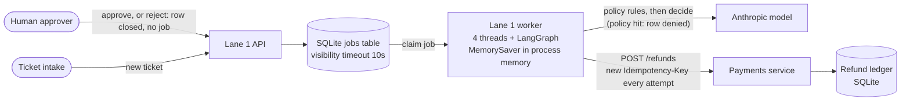
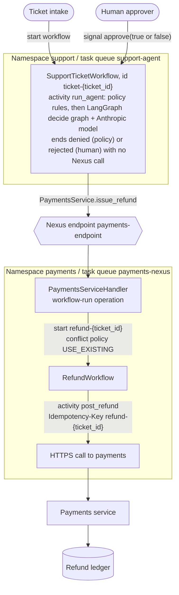
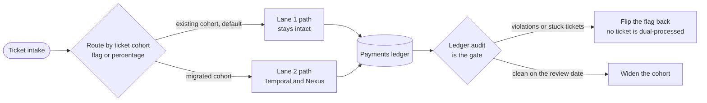

# Architecture

Two lanes handle the same refund tickets under the same chaos. An independent audit reads only the payments
ledger, so neither lane grades itself. Names below are the real ones from the code.

## The process, in one paragraph

A helpdesk ticket asks for a refund. The support agent (LangGraph plus an Anthropic model) first checks two
policy rules in code: at most $200, and an order at most 30 days old. A ticket that breaks one is denied without
calling the model and closes with no refund. Otherwise the model proposes `refund` or `deny`. A proposed refund
needs a human decision, which can take hours or days; the human approves it or says no. After approval, the payments team's service moves the
money. Lane 1 is the stack a competent team ships today. Lane 2 runs the same agent logic on Temporal and
reaches the payments team through a Nexus operation.

## Lane 1: queue, in-memory graph, HTTPS to payments

What makes it realistic, and what makes it fail:

- The queue is at-least-once. A job whose visibility timeout expires is handed out again. (A decide job's worker
  heartbeats its lease while the Claude call runs, so only a dead worker's job comes back.)
- The LangGraph checkpointer is `MemorySaver`, the tutorial default. The approval interrupt lives in the worker's
  memory and disappears when the worker restarts.
- A recovery path re-drives tickets stuck in `executing`. That is what turns a crash after the payments commit
  into a second refund.
- Each attempt to call payments uses a fresh idempotency key (`l1-{ticket_id}-{random}`), a very common mistake.

## Lane 2: Temporal across two namespaces, joined by Nexus

Who owns what:

| Piece | Owner | Notes |
|---|---|---|
| `SupportTicketWorkflow`, `run_agent` | Support/AI team | The agent logic is the same decide graph Lane 1 uses, called from an activity. |
| `PaymentsService.issue_refund` contract | Payments team | One operation, one input and one output type. The support side imports only this contract. |
| `PaymentsServiceHandler`, `RefundWorkflow`, `post_refund` | Payments team | The support team never sees this namespace, task queue or workflow. |
| Ledger and idempotency check | Payments team | The idempotency key (`refund-{ticket_id}`) is derived from the ticket, not from the attempt. |

## One refund, including the failure that matters

Payments commits the refund and the response never arrives. The caller cannot tell whether money moved.

Durable execution alone does not make this safe. Temporal retries the activity, but the money moves once only
because the idempotency key comes from the business operation (the ticket), and the ledger refuses a second
refund for the same key. The workflow ID `refund-{ticket_id}` is a second layer: a retried Nexus start attaches to
the running workflow instead of starting another.

## How the two lanes are scored

The three invariants: every approved ticket is refunded exactly once, no refund without an approval, and no
ticket is lost or stuck. The audit compares the harness's record of tickets and human decisions with the ledger.
Tickets owed nothing (outside the policy, or a human said no) must have no refund; one with a refund counts as
"refunded without approval". It does
not read either lane's own state. It only scores tickets the harness recorded, so a refund for an unrecorded
ticket would not be counted.

## A migration path

## Lane 1 realism

Lane 1 is meant to be the system a competent team ships today, so its flaws are the common ones, not invented ones.
Change it only with a reason, and write the reason here. On screen it is "Queue + LangGraph", named the way "Temporal +
Nexus" is; avoid labels like "traditional" or "hand-rolled", which read as a strawman.

- **Per-attempt idempotency key.** The client sends a fresh key each try. A very common bug; deriving the key from the
  ticket is a one-line fix that closes the redelivery and payments-quiet duplicates. `PAIDONCE_L1_STABLE_KEY=1` applies
  that fix so `make scenario` can measure it (duplicates drop to zero, the lost tickets remain). It is off by default.
- **`MemorySaver`, the LangGraph tutorial default.** The approval interrupt lives in worker memory and is lost when the
  worker restarts.
- **At-least-once queue with a visibility timeout,** plus a recovery path that re-drives tickets stuck in `executing`.
  That path is what turns a crash after the payments commit into a second refund.
- **A decide job's worker heartbeats its lease** (every third of the visibility timeout), because a model call can
  outlast the 10 s timeout. Without it a live job was handed to a second worker. Execute jobs keep the plain timeout, so
  a `kill -9` still makes the job reappear.
- **A human "no" is handled at the API:** `POST /tickets/{id}/reject` marks the row `rejected` and queues no job, so
  redelivery and recovery never see it. That is how a team would build it.
- **A careful dedupe check for finished tickets,** so redelivery after completion is a no-op. Duplicates only arise for
  work still in flight.
- **Not built:** a hardened third lane (outbox, sweeper, durable checkpointer). What it would fix is argued, not
  measured.

## HTTPS between services

Payments (:8101) and the Lane 1 API (:8102) serve HTTPS with their own self-signed certificates (`paidonce/tls.py`),
generated once under `data/tls/` (gitignored) before anything starts. `<service>.pem` holds the key (mode 0600) and only
that service reads it; callers read `<service>.crt`.

Callers never turn verification off. Lane 1's `call_payments`, Lane 2's `post_refund` activity and the show engine each
load the certificate of the one service they call as their only trust anchor (`tls.client_verify`), so a different
certificate on the port fails the handshake, and the payments certificate does not open the Lane 1 API. The certificates
name `127.0.0.1`, `::1` and `localhost`, last a year, and are replaced within 30 days of expiry. Both lanes pay the same
handshake cost. `PAIDONCE_PAYMENTS_TLS=0` and `PAIDONCE_LANE1_TLS=0` serve plain HTTP, which the tests use. The show
server on :8100 stays plain HTTP on loopback: it is what the browser opens.

## What is not tested here

- **Retargeting the Nexus endpoint while operations are in flight.** Temporal's docs say new operations route to the
  updated target immediately; for a namespace change, completion callbacks stay with the original handler namespace and
  the docs recommend draining first (https://docs.temporal.io/nexus/registry). They do not say what a task-queue change
  does to in-flight operations, and this repository does not test either case.
- **Workflow versioning** with executions in flight, and **long approval waits**: the demo waits seconds, not days.
