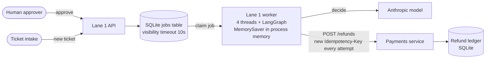
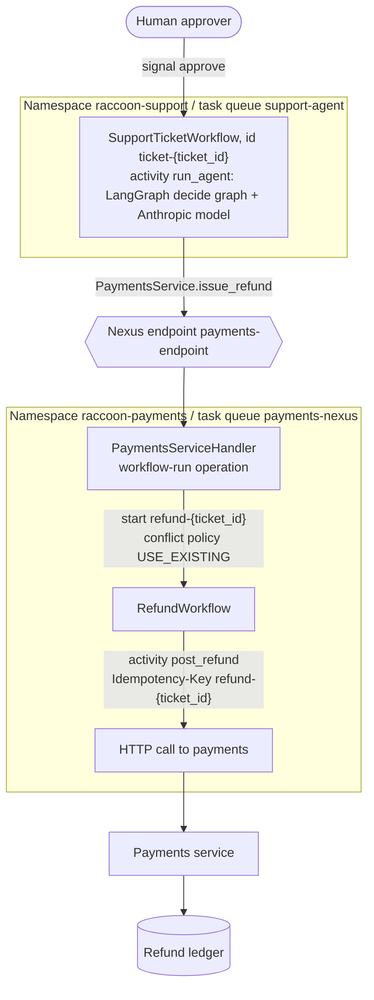
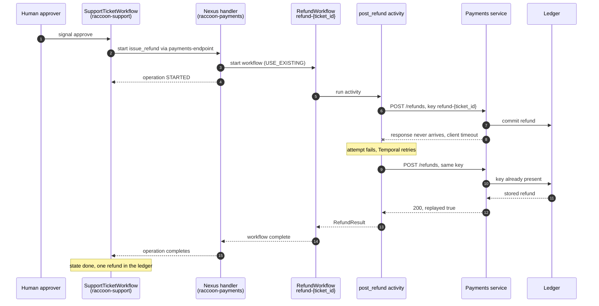
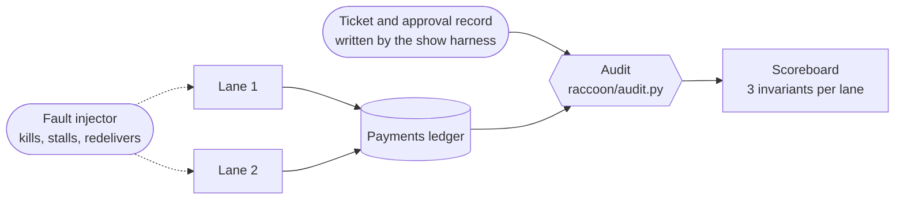

# Architecture

Two lanes handle the same refund tickets under the same chaos. An independent audit reads only the payments
ledger, so neither lane grades itself. Names below are the real ones from the code.

## The process, in one paragraph

A support agent (LangGraph plus an Anthropic model) reads a ticket and proposes `refund` or `deny`. A refund
needs a human approval, which can take hours or days. After approval, the payments team's service moves the
money. Lane 1 is the stack a competent team ships today. Lane 2 runs the same agent logic on Temporal and
reaches the payments team through a Nexus operation.

## Lane 1: queue, in-memory graph, plain HTTP

What makes it realistic, and what makes it fail:

- The queue is at-least-once. A job whose visibility timeout expires is handed out again.
- The LangGraph checkpointer is `MemorySaver`, the tutorial default. The approval interrupt lives in the worker's
  memory and disappears when the worker restarts.
- A recovery path re-drives tickets stuck in `executing`. That is what turns a crash after the payments commit
  into a second refund.
- Each attempt to call payments uses a fresh idempotency key (`l1-{ticket_id}-{random}`), a very common mistake.

## Lane 2: Temporal across two namespaces, joined by Nexus

Who owns what:

| Piece | Owner | Notes |
|---|---|---|
| `SupportTicketWorkflow`, `run_agent` | Support/AI team | The agent logic is the same decide graph Lane 1 uses, called from an activity. |
| `PaymentsService.issue_refund` contract | Payments team | One operation, one input and one output type. The support side imports only this contract. |
| `PaymentsServiceHandler`, `RefundWorkflow`, `post_refund` | Payments team | The support team never sees this namespace, task queue or workflow. |
| Ledger and idempotency check | Payments team | The idempotency key (`refund-{ticket_id}`) is derived from the ticket, not from the attempt. |

## One refund, including the failure that matters

Payments commits the refund and the response never arrives. The caller cannot tell whether money moved.

Durable execution alone does not make this safe. Temporal retries the activity, but the money moves once only
because the idempotency key comes from the business operation (the ticket), and the ledger refuses a second
refund for the same key. The workflow ID `refund-{ticket_id}` is a second layer: a retried Nexus start attaches to
the running workflow instead of starting another.

## How the two lanes are scored

The three invariants: every approved ticket is refunded exactly once, no refund without an approval, and no
ticket is lost or stuck. The audit compares the harness's record of tickets and approvals with the ledger. It does
not read either lane's own state. It only scores tickets the harness recorded, so a refund for an unrecorded
ticket would not be counted.

## Migration shape (what the case study proposes)

## What is not tested here

- **Retargeting the Nexus endpoint while operations are in flight.** Temporal's docs say new operations route to the
  updated target immediately; for a namespace change, completion callbacks stay with the original handler namespace and
  the docs recommend draining first (https://docs.temporal.io/nexus/registry). They do not say what a task-queue change
  does to in-flight operations, and this repository does not test either case.
- **Workflow versioning** with executions in flight, and **long approval waits**: the demo waits seconds, not days.
